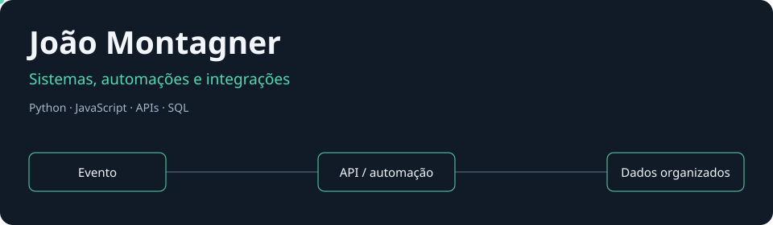
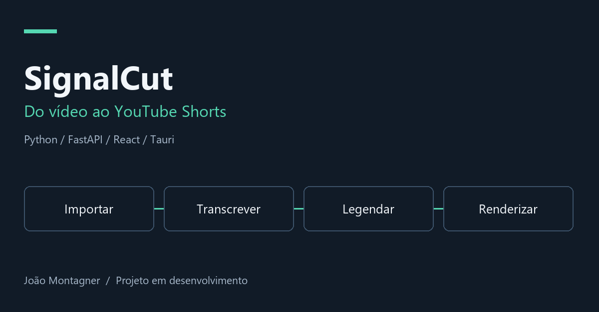
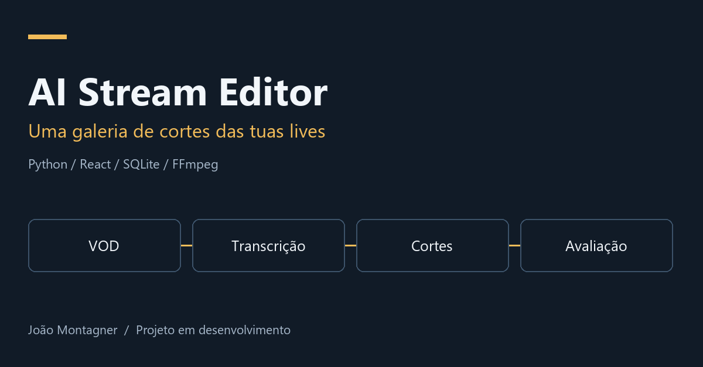
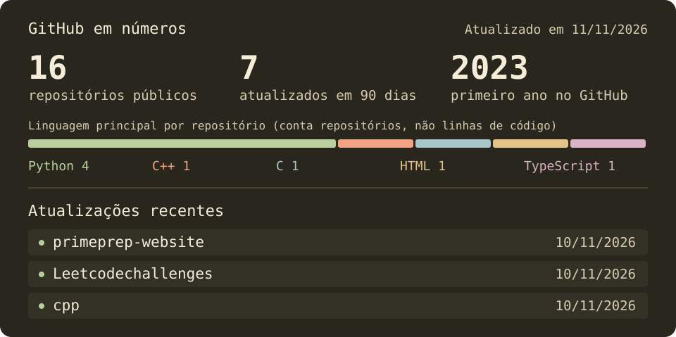

Desenvolvo sistemas para automatizar processos e conectar ferramentas. Estudo **ADS na PUCRS**, tenho **inglês C2** e busco vagas e projetos de desenvolvimento, com preferência por trabalho remoto.

## O que estou construindo

<table>
<tr><td width="50%" valign="top">

### 🎬 SignalCut

Aplicativo desktop que transforma vídeos em clipes verticais, com importação, transcrição, legendas, renderização e fila de publicação para YouTube Shorts.

**Python · FastAPI · React · TypeScript · Tauri · FFmpeg**

[Explorar o projeto →](https://github.com/4Kwko/youtube-shorts-poster)

</td><td width="50%" valign="top">

### 📺 AI Stream Editor

Automação local para buscar VODs da Twitch e produzir uma galeria de cortes para avaliação. Processa transcrição, legendas e vídeo com Python e FFmpeg.

**Python · React · TypeScript · SQLite · faster-whisper**

[Explorar o projeto →](https://github.com/4Kwko/ai-stream-editor)

</td></tr>
</table>

Os dois projetos estão em desenvolvimento. Os repositórios documentam execução, testes e pontos que ainda precisam de validação com vídeos reais.

### Por onde começar no código

| Projeto | O que examinar | Caminhos diretos |
| --- | --- | --- |
| SignalCut | Separação entre API, serviços, persistência e processamento em fila. | [Backend](https://github.com/4Kwko/youtube-shorts-poster/tree/main/backend/app) · [Testes](https://github.com/4Kwko/youtube-shorts-poster/tree/main/tests) · [Execução](https://github.com/4Kwko/youtube-shorts-poster#desktop-development-on-windows) |
| AI Stream Editor | Automação de VODs, processamento local e avaliação dos cortes na galeria. | [Backend](https://github.com/4Kwko/ai-stream-editor/tree/main/backend/ai_stream_editor) · [Testes](https://github.com/4Kwko/ai-stream-editor/tree/main/backend/tests) · [Contrato HTTP](https://github.com/4Kwko/ai-stream-editor/blob/main/docs/coordination/integration-contract.md) |

Minha experiência criando vídeos motivou esses projetos. Eles reúnem duas áreas em que trabalho — desenvolvimento de sistemas e produção de conteúdo.

### 💬 Prime Prep Chatbot

Chatbot de atendimento no Instagram com menus, cadastro confirmado e pausa para atendimento humano. Desenvolvi para a Prime Prep, curso que fundei e que está em pausa.

**Python · FastAPI · SQLite** · [Código](https://github.com/4Kwko/primeprep-chatbot) · [Testar sem Instagram](https://github.com/4Kwko/primeprep-chatbot#teste-o-fluxo-sem-instagram)

### 🔗 Uma integração usada por uma empresa

Transformei mensagens e áudios de compras no WhatsApp em registros no Google Sheets, com identificadores e permissões para funcionários e administradores. **Python · JavaScript · OpenAI · Google Sheets API.** [Estudo de caso](case-studies/whatsapp-purchases.md)

## Ferramentas que uso

## Atividade por aqui

Um pouco mais sobre mim

Dou aulas de inglês na Fisk São Gabriel, tenho certificações ECPE C2 e MET C1 e experiência com tradução de artigos científicos. Também produzo conteúdo para TikTok e Instagram, o que me levou a desenvolver ferramentas próprias para trabalhar com vídeo.

