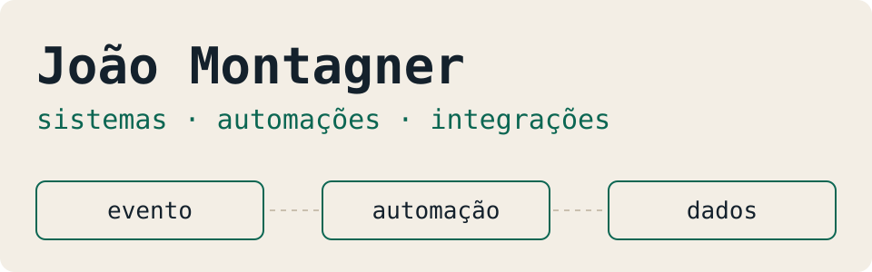
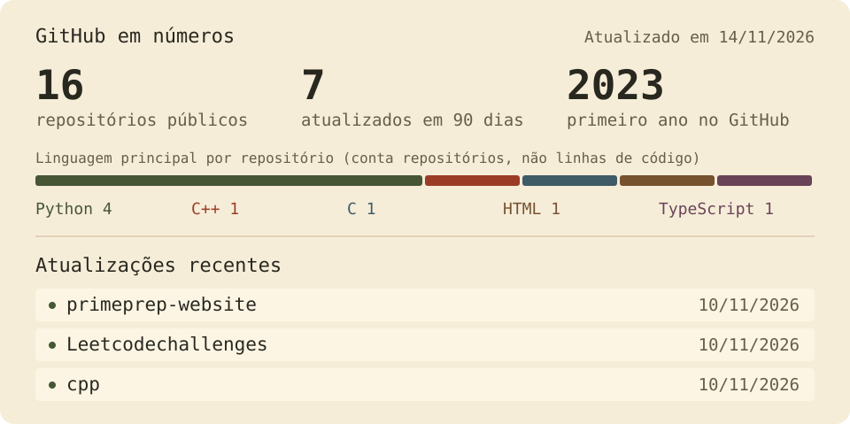

<picture>
  <source media="(prefers-color-scheme: dark)" srcset="assets/banner-pt-dark.svg" />
  
</picture>

<a href="https://www.linkedin.com/in/jo%C3%A3o-montagner-704aa92b5/">LinkedIn</a> ·
<a href="docs/README.en.md">Read in English</a>

Desenvolvo sistemas para automatizar processos e conectar ferramentas, principalmente com Python, APIs e SQL. Estudo **Análise e Desenvolvimento de Sistemas na PUCRS**, tenho **inglês C2** e busco vagas e projetos de desenvolvimento, de preferência remotos.

## O que estou construindo

### 🎬 SignalCut

Aplicativo desktop que transforma vídeos em clipes verticais com legenda: importa por URL ou arquivo, transcreve no próprio computador, renderiza em 1080×1920 e mantém uma fila de publicação para o YouTube Shorts.

**Python · FastAPI · SQLAlchemy · React · TypeScript · Tauri · FFmpeg**

[Código](https://github.com/4Kwko/youtube-shorts-poster) · [Arquitetura](https://github.com/4Kwko/youtube-shorts-poster#como-funciona) · [Backend](https://github.com/4Kwko/youtube-shorts-poster/tree/main/backend/app) · [Testes](https://github.com/4Kwko/youtube-shorts-poster#testes-e-verificação) · [Como executar](https://github.com/4Kwko/youtube-shorts-poster#executar)

### 📺 AI Stream Editor

Automação local que acompanha um canal da Twitch, baixa os VODs novos e gera cortes com legenda para uma galeria de avaliação. A seleção dos trechos é heurística e ainda não foi validada com lives reais.

**Python · FastAPI · faster-whisper · FFmpeg · SQLite · React · TypeScript**

[Código](https://github.com/4Kwko/ai-stream-editor) · [Arquitetura](https://github.com/4Kwko/ai-stream-editor#como-funciona) · [Backend](https://github.com/4Kwko/ai-stream-editor/tree/main/backend/ai_stream_editor) · [Decisões](https://github.com/4Kwko/ai-stream-editor/tree/main/docs/decisions) · [Contrato HTTP](https://github.com/4Kwko/ai-stream-editor/blob/main/docs/coordination/integration-contract.md)

Os dois estão em desenvolvimento e têm testes automatizados. Os READMEs mostram o que foi verificado e o que ainda falta validar. Criar vídeos foi o que me levou a escrever essas ferramentas.

### 🎓 Prime Prep: site e chatbot

 

Para a Prime Prep, curso preparatório militar que fundei e que está em pausa, desenvolvi:

- **Site institucional** estático, com diagnóstico de concurso calculado no navegador, 173 testes e suporte a movimento reduzido, alto contraste e impressão. Nunca foi publicado em um domínio. **Next.js · React · TypeScript** · [Código](https://github.com/4Kwko/primeprep-website)
- **Chatbot de atendimento no Instagram**, com menus, cadastro de interessados e pausa para atendimento humano. **Python · FastAPI · SQLite** · [Código](https://github.com/4Kwko/primeprep-chatbot) · [Testar sem Instagram](https://github.com/4Kwko/primeprep-chatbot#teste-o-fluxo-sem-instagram)

### 🔗 Uma integração usada por uma empresa

Transformei mensagens e áudios de compras no WhatsApp em registros no Google Sheets, com identificadores e permissões para funcionários e administradores. O código não é público. **Python · JavaScript · OpenAI · Google Sheets API** · [Estudo de caso](case-studies/whatsapp-purchases.md)

## Estudando agora

Algoritmos e estruturas de dados em C e C++, resolvendo problemas do LeetCode ([C](https://github.com/4Kwko/Leetcodechallenges) · [C++](https://github.com/4Kwko/cpp)). É um estudo no começo, com interesse em programação competitiva.

## Ferramentas que uso

## Atividade por aqui

<picture>
  <source media="(prefers-color-scheme: dark)" srcset="assets/stats-pt-dark.svg" />
  
</picture>

[Ver os repositórios por ordem de atualização](https://github.com/4Kwko?tab=repositories&sort=updated)

Um pouco mais sobre mim

Dou aulas de inglês na Fisk São Gabriel, tenho certificações ECPE C2 e MET C1 e já traduzi artigos científicos. Também produzo conteúdo para TikTok e Instagram, o que me levou a desenvolver ferramentas próprias para trabalhar com vídeo.

