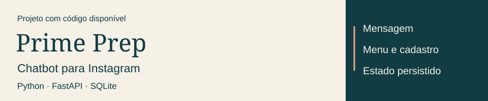

<picture>
  <source media="(prefers-color-scheme: dark) and (max-width: 600px)" srcset="assets/identity-dark-mobile.svg" />
  <source media="(max-width: 600px)" srcset="assets/identity-light-mobile.svg" />
  <source media="(prefers-color-scheme: dark)" srcset="assets/identity-dark.svg" />
  
</picture>

  <a href="https://www.linkedin.com/in/jo%C3%A3o-montagner-704aa92b5/"><strong>Contato / LinkedIn</strong></a> &nbsp; · &nbsp;
  <a href="https://github.com/4Kwko/primeprep-chatbot#teste-o-fluxo-sem-instagram">Executar uma demonstração</a> &nbsp; · &nbsp;
  <a href="docs/README.en.md">English</a>

Desenvolvo sistemas para conectar ferramentas e organizar processos. Trabalho com **Python, APIs e SQL**, estudando o problema e implementando o fluxo completo. Busco oportunidades em **desenvolvimento, automação e integrações**, com preferência por trabalho remoto.

### 01 / Projeto para explorar

Construí o chatbot para a **Prime Prep**, projeto educacional que fundei. Ele responde por menus, registra interessados após confirmação e pausa as respostas para atendimento humano. Desenvolvi também o site e a presença digital do projeto, que está em pausa.

**[Repositório](https://github.com/4Kwko/primeprep-chatbot)** · [Código do bot](https://github.com/4Kwko/primeprep-chatbot/blob/main/main.py) · [Demonstração sem token](https://github.com/4Kwko/primeprep-chatbot#teste-o-fluxo-sem-instagram) · [Arquitetura](https://github.com/4Kwko/primeprep-chatbot/blob/main/docs/architecture.md)

### 02 / Uma automação que foi usada

**WhatsApp → extração de dados → Google Sheets.** Uma empresa preenchia compras manualmente no Excel. Desenvolvi uma integração para receber texto ou áudio, extrair produto, preço e data e registrar os dados em uma planilha compartilhada. Incluí IDs dos registros e permissões diferentes para funcionários e administradores.

`Python` `JavaScript` `OpenAI` `Google Sheets API`

[Ver o estudo de caso](case-studies/whatsapp-purchases.md) — solução utilizada pela empresa; código não publicado e sem métricas de economia de tempo disponíveis.

### 03 / Ferramentas e outros trabalhos

| Foco | Tecnologias |
| :--- | :--- |
| Sistemas e integrações | Python · JavaScript · APIs · FastAPI |
| Dados | SQL · MySQL · SQLite · Supabase |
| Projetos e estudos | React · TypeScript · C · C++ |

[Jogo em Python](https://github.com/4Kwko/kodland-endlessrunnerpy) · [Notas de bancos de dados](https://github.com/4Kwko/DatabaseSummary) · [Estudos em C++](https://github.com/4Kwko/cpp)

<strong>Formação, inglês e outras experiências</strong>

- Análise e Desenvolvimento de Sistemas na **PUCRS**, desde 2026. Estudei Ciência da Computação na UFN entre 2024 e 2026, antes da transferência.
- Inglês **ECPE C2 (2024)** e **MET C1 (2022)**. Professor de inglês na Fisk São Gabriel desde agosto de 2023.
- Tradução de artigos científicos publicados em trabalhos ligados à UFRGS e à UFSM.
- Uso Claude Code, Codex e MCPs como apoio ao desenvolvimento. Costumo organizar as etapas e estudar as tecnologias necessárias antes de implementar.
- Criação de conteúdo no [TikTok](https://www.tiktok.com/@joao.montagner) e no [Instagram](https://www.instagram.com/joao.montagner/) como atividade secundária.

---

**Vamos conversar sobre uma vaga ou um projeto? [Me chama no LinkedIn.](https://www.linkedin.com/in/jo%C3%A3o-montagner-704aa92b5/)**
