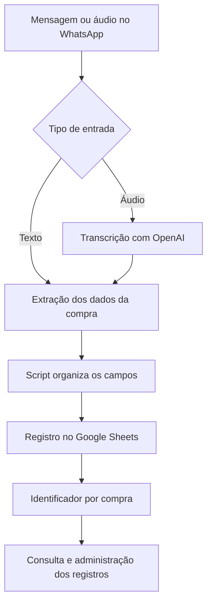

# Registro de compras pelo WhatsApp

[Voltar ao perfil](../README.md)

## O problema

Uma empresa usava uma planilha do Excel para preencher produto, preço e data de compra e somar o custo total. O registro exigia inserir cada coluna manualmente.

Desenvolvi uma integração para que a equipe pudesse registrar compras no ambiente em que já se comunicava: um grupo do WhatsApp.

## Como funcionava

O funcionário enviava uma mensagem livre ou um áudio, por exemplo: “Comprei um pacote de folha A4 por 30 reais”. Esse é um exemplo ilustrativo, sem dados de compras reais.

As mensagens continuavam no grupo, enquanto a planilha compartilhada concentrava os registros estruturados.

## Permissões e manutenção do histórico

| Perfil | Operações |
| --- | --- |
| Funcionário | Registrar compras. |
| Administrador | Registrar, excluir compras pelo identificador e limpar o histórico. |

Os identificadores permitiam localizar uma compra específica quando fosse necessário corrigir um problema, sem depender apenas de procurar a mensagem na conversa.

## Minha participação

Desenvolvi a integração e os scripts usando Python, JavaScript, OpenAI e a API do Google Sheets. A empresa chegou a utilizar a solução. O objetivo era facilitar o registro e manter um histórico acessível à equipe.

## O que está disponível

O código não foi publicado no GitHub. Na época, eu ainda não tinha uma organização adequada dos repositórios e não tenho uma versão pública para compartilhar aqui.

Este documento é uma descrição retrospectiva do projeto, não uma demonstração executável nem uma reconstrução do código original. Não há métricas medidas de redução de tempo, custos ou erros publicadas.

Para examinar um projeto com código e demonstração local, veja o [chatbot da Prime Prep](https://github.com/4Kwko/primeprep-chatbot). São projetos distintos: o chatbot do Instagram não transcreve áudio nem registra compras no Google Sheets.
