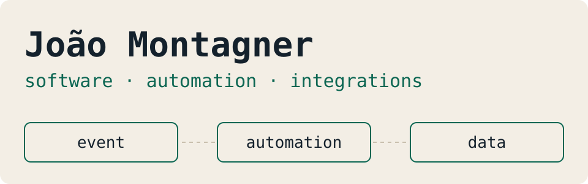
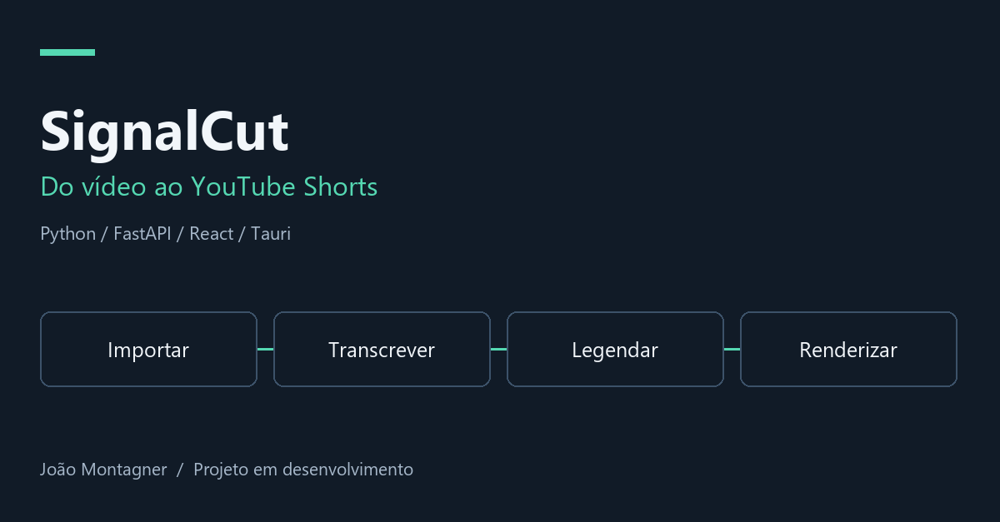
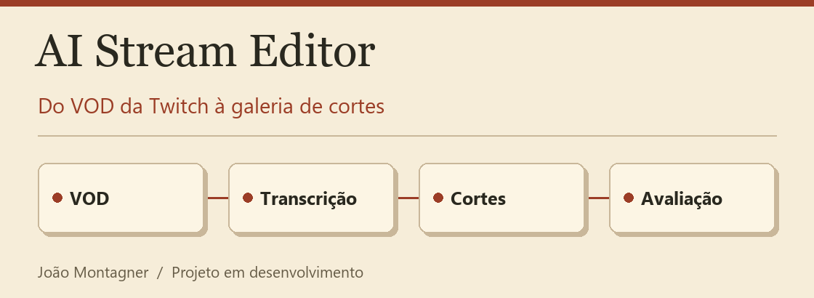
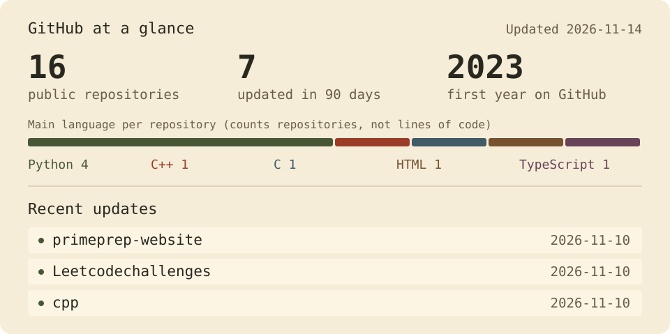

<picture>
  <source media="(prefers-color-scheme: dark)" srcset="../assets/banner-en-dark.svg" />
  
</picture>

<a href="https://www.linkedin.com/in/jo%C3%A3o-montagner-704aa92b5/">LinkedIn</a> ·
<a href="../README.md">Português</a>

I build software that automates processes and connects tools, mostly with Python, APIs and SQL. I study **Systems Analysis and Development at PUCRS**, hold a **C2 English certificate** and am looking for development roles and projects, preferably remote.

## What I am building

### 🎬 SignalCut

A desktop app that turns videos into captioned vertical clips: it imports from a URL or a file, transcribes on your own machine, renders at 1080×1920 and keeps a publishing queue for YouTube Shorts.

**Python · FastAPI · SQLAlchemy · React · TypeScript · Tauri · FFmpeg**

[Code](https://github.com/4Kwko/youtube-shorts-poster/blob/main/docs/README.en.md) · [Architecture](https://github.com/4Kwko/youtube-shorts-poster/blob/main/docs/README.en.md#how-it-works) · [Backend](https://github.com/4Kwko/youtube-shorts-poster/tree/main/backend/app) · [Tests](https://github.com/4Kwko/youtube-shorts-poster/blob/main/docs/README.en.md#tests-and-verification) · [Running it](https://github.com/4Kwko/youtube-shorts-poster/blob/main/docs/README.en.md#running-it)

### 📺 AI Stream Editor

Local automation that watches a Twitch channel, downloads new VODs and produces captioned clips for a review gallery. Segment selection is heuristic and has not been validated on real streams yet.

**Python · FastAPI · faster-whisper · FFmpeg · SQLite · React · TypeScript**

[Code](https://github.com/4Kwko/ai-stream-editor/blob/main/docs/README.en.md) · [Architecture](https://github.com/4Kwko/ai-stream-editor/blob/main/docs/README.en.md#how-it-works) · [Backend](https://github.com/4Kwko/ai-stream-editor/tree/main/backend/ai_stream_editor) · [Decisions](https://github.com/4Kwko/ai-stream-editor/tree/main/docs/decisions) · [HTTP contract](https://github.com/4Kwko/ai-stream-editor/blob/main/docs/coordination/integration-contract.md)

Both are in development and have automated tests. Their READMEs separate what has been verified from what still needs validation. Making videos is what led me to write these tools.

### 💬 Prime Prep Chatbot

An Instagram support chatbot with menus, lead registration and a pause for human support. I built it for Prime Prep, the exam prep course I founded, which is currently on hold.

**Python · FastAPI · SQLite** · [Code](https://github.com/4Kwko/primeprep-chatbot/blob/main/docs/README.en.md) · [Try it without Instagram](https://github.com/4Kwko/primeprep-chatbot/blob/main/docs/README.en.md#try-the-conversation-locally)

### 🔗 An integration used by a business

I turned WhatsApp purchase messages and voice notes into Google Sheets records, with IDs and separate employee/admin permissions. The code is not public. **Python · JavaScript · OpenAI · Google Sheets API** · [Case study (Portuguese)](../case-studies/whatsapp-purchases.md)

## Currently studying

Algorithms and data structures in C and C++, working through LeetCode problems ([C](https://github.com/4Kwko/Leetcodechallenges) · [C++](https://github.com/4Kwko/cpp)). It is an early-stage effort, with an interest in competitive programming.

## Tools I use

Python · TypeScript · React · FastAPI · MySQL · SQLite · Supabase

## Activity

<picture>
  <source media="(prefers-color-scheme: dark)" srcset="../assets/stats-en-dark.svg" />
  
</picture>

A bit more about me

I teach English at Fisk São Gabriel, hold the ECPE C2 and MET C1 certificates and have translated scientific articles. I also make videos for TikTok and Instagram, which led me to build my own video tools.

