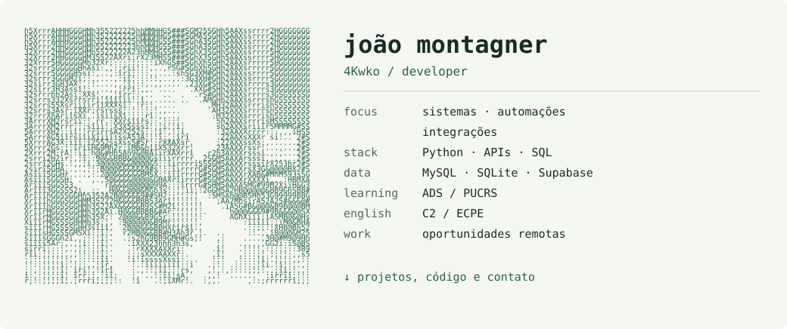

<picture>
  <source media="(prefers-color-scheme: dark) and (max-width: 600px)" srcset="../assets/identity-dark-mobile.svg" />
  <source media="(max-width: 600px)" srcset="../assets/identity-light-mobile.svg" />
  <source media="(prefers-color-scheme: dark)" srcset="../assets/identity-dark.svg" />
  
</picture>

[Contact / LinkedIn](https://www.linkedin.com/in/jo%C3%A3o-montagner-704aa92b5/) · [Run a demo](https://github.com/4Kwko/primeprep-chatbot/blob/main/docs/README.en.md#try-it-without-instagram) · [Português](../README.md)

I develop systems that connect tools and organize processes, working with **Python, APIs and SQL**. I am seeking opportunities in **software development, automation and integrations**, preferably remote.

### 01 / Explore a project

**[Prime Prep Instagram chatbot](https://github.com/4Kwko/primeprep-chatbot)** — Python, FastAPI and SQLite.

I built this menu-based chatbot for the education venture I founded. It answers course inquiries, saves prospective students after confirmation, persists conversation state and pauses automated replies for human support. The venture is currently on hold.

[Source code](https://github.com/4Kwko/primeprep-chatbot/blob/main/main.py) · [Offline demo and English guide](https://github.com/4Kwko/primeprep-chatbot/blob/main/docs/README.en.md) · [Architecture](https://github.com/4Kwko/primeprep-chatbot/blob/main/docs/architecture.md)

### 02 / An automation used by a business

**WhatsApp → data extraction → Google Sheets.** I replaced manual spreadsheet entry with an integration that accepts text or voice messages, extracts purchase details and writes them to a shared spreadsheet. It includes record IDs and separate employee/admin permissions.

`Python` `JavaScript` `OpenAI` `Google Sheets API`

[Read the case study in Portuguese](../case-studies/whatsapp-purchases.md). The company used the solution; its source code is not public, and no measured time savings are available.

### 03 / Tools and other work

| Focus | Technologies |
| :--- | :--- |
| Systems and integrations | Python · JavaScript · APIs · FastAPI |
| Data | SQL · MySQL · SQLite · Supabase |
| Projects and studies | React · TypeScript · C · C++ |

[Python game](https://github.com/4Kwko/kodland-endlessrunnerpy) · [Database notes](https://github.com/4Kwko/DatabaseSummary) · [C++ studies](https://github.com/4Kwko/cpp)

<strong>Education, English and other experience</strong>

- Systems Analysis and Development at PUCRS since 2026, following Computer Science studies at UFN from 2024 to 2026.
- ECPE C2 (2024) and MET C1 (2022). English teacher at Fisk São Gabriel since August 2023.
- Translated published scientific articles connected with UFRGS and UFSM.
- I use Claude Code, Codex and MCP integrations to support development, alongside studying the problem and planning the implementation.
- Content creation on TikTok and Instagram is a secondary activity.

---

**Have a role or project in mind? [Let's talk on LinkedIn.](https://www.linkedin.com/in/jo%C3%A3o-montagner-704aa92b5/)**
