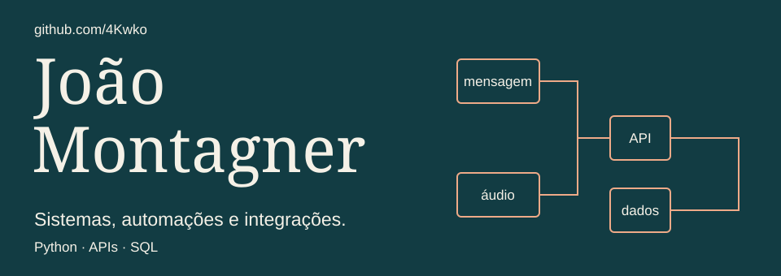

# João Montagner

I develop systems and automations that connect tools, organize information and make everyday tasks easier. My focus is **Python, APIs and databases**.

I am studying Systems Analysis and Development at PUCRS after studying Computer Science at UFN. I am interested in technology opportunities, preferably remote.

[LinkedIn](https://www.linkedin.com/in/jo%C3%A3o-montagner-704aa92b5/) · [Português](../README.md)

## Start with this project

**[Prime Prep Instagram chatbot](https://github.com/4Kwko/primeprep-chatbot)**

I developed a menu-based chatbot for the education venture I founded. It handles course inquiries, collects prospective-student information, persists conversation state and pauses automated responses for human support.

Built with Python, FastAPI, the Instagram API and SQLite. The repository includes an offline terminal demo, architecture notes and automated checks. Prime Prep is currently on hold; the code is available for evaluation.

[Read the code](https://github.com/4Kwko/primeprep-chatbot/blob/main/main.py) · [Try the local demo](https://github.com/4Kwko/primeprep-chatbot/blob/main/docs/README.en.md)

## A workflow I automated

A business recorded purchases manually in Excel. I built an integration that accepted WhatsApp messages and voice notes, extracted purchase information and wrote it to a shared Google Sheets spreadsheet. It included record IDs and separate employee and administrator permissions. The business used the solution.

Technologies: Python, JavaScript, OpenAI and the Google Sheets API. The source code is not public. The [case study](../case-studies/whatsapp-purchases.md) documents the workflow and its evidence boundaries in Portuguese.

## Tools and studies

| Area | Technologies and context |
| --- | --- |
| Automation and integrations | Python, JavaScript, APIs and message processing. |
| Data | SQL, MySQL, SQLite and Supabase. |
| Web development | React and TypeScript in projects and prototypes. |
| Studies | C, C++, algorithms and database fundamentals. |

I use Claude Code, Codex and MCP integrations as development tools. I usually study the problem and required technologies, plan the steps and then implement the solution.

Other public material includes an [endless runner in Python](https://github.com/4Kwko/kodland-endlessrunnerpy), [bilingual database notes](https://github.com/4Kwko/DatabaseSummary) and [C++ exercises](https://github.com/4Kwko/cpp).

## Beyond software

I teach English at Fisk São Gabriel and hold ECPE C2 and MET C1 certificates. I have also translated published scientific articles in work related to UFRGS and UFSM. I independently create TikTok and Instagram content as a secondary activity.

For a role or a software project, [contact me on LinkedIn](https://www.linkedin.com/in/jo%C3%A3o-montagner-704aa92b5/).
